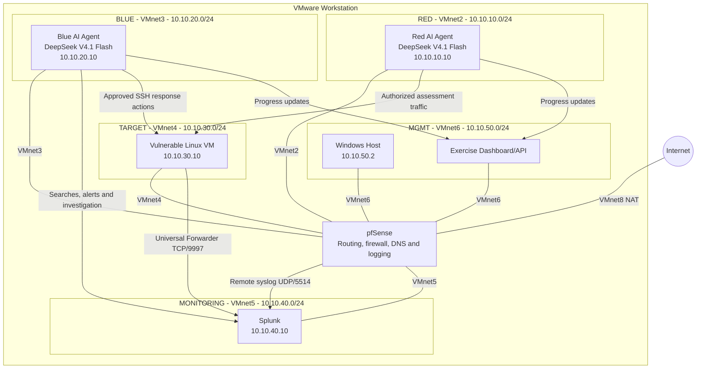

# Autonomous Red/Blue Team Lab

## Overview

This lab simulates a controlled red-team/blue-team cybersecurity exercise between
two autonomous AI systems. Both agents are powered by **DeepSeek V4.1 Flash** and
operate against an isolated vulnerable Linux virtual machine.

The red agent performs a black-box security assessment of the target. The blue
agent monitors the environment through Splunk, investigates alerts, and performs
approved response actions. pfSense provides network isolation, routing, firewall
enforcement, and network telemetry.

The environment is intended for authorized security research and experimentation
inside an isolated VMware Workstation lab.

## Objectives

- Evaluate autonomous offensive and defensive agent behavior.
- Observe how the agents plan, execute, and adapt during an exercise.
- Measure the blue agent's ability to detect and investigate red-team activity.
- Correlate network telemetry with Linux host activity.
- Preserve strong isolation between the lab, the Windows host, and external
  networks.
- Provide a dashboard that shows both agents' progress and the state of the
  exercise.

## Architecture

## Network Segmentation

VMware Workstation uses a separate host-only VMnet for each security zone. This
provides equivalent isolation to VLAN-backed access networks without requiring an
802.1Q trunk.

| Zone | VMnet | Subnet | pfSense address | Primary system |
|---|---|---|---|---|
| WAN | VMnet8 | VMware NAT | DHCP | Internet uplink |
| RED | VMnet2 | `10.10.10.0/24` | `10.10.10.1` | Red AI agent |
| BLUE | VMnet3 | `10.10.20.0/24` | `10.10.20.1` | Blue AI agent |
| TARGET | VMnet4 | `10.10.30.0/24` | `10.10.30.1` | Vulnerable Linux VM |
| MONITORING | VMnet5 | `10.10.40.0/24` | `10.10.40.1` | Splunk |
| MGMT | VMnet6 | `10.10.50.0/24` | `10.10.50.1` | Windows host and dashboard |

Only VMnet6 has a Windows host adapter. The TARGET network is not attached to a
bridged network, VMware NAT, or a host-accessible VMnet.

Because RED and TARGET use different VMnets and IP subnets, all RED-to-TARGET
traffic is routed through pfSense. pfSense can therefore permit, block, log, or
capture every connection crossing that boundary.

## Core Components

### Red AI Agent

- Powered by DeepSeek V4.1 Flash.
- Performs a black-box assessment of the vulnerable Linux VM.
- Receives explicit objectives and scope before the exercise starts.
- Interacts only with approved target addresses and services.
- Reports status, findings, and progress to the dashboard API.
- Cannot access the blue or monitoring networks.

### Blue AI Agent

- Powered by DeepSeek V4.1 Flash.
- Deploys and maintains approved Splunk searches and alerts.
- Begins its response workflow when an alert is triggered.
- Uses Splunk tooling to search and correlate telemetry.
- May use SSH for approved investigation or containment actions on the target.
- Reports investigation and response progress to the dashboard API.

### Vulnerable Linux VM

- Provides an intentionally vulnerable, medium- or easy-difficulty target.
- Hosts the services assessed by the red agent.
- Sends operating-system and security logs to Splunk through the Splunk
  Universal Forwarder.
- Is restored to a known-clean VMware snapshot after each exercise.
- Has no unrestricted access to internal networks.

### Splunk

- Receives pfSense remote syslog on UDP port `5514`.
- Receives Linux events from the Universal Forwarder on TCP port `9997`.
- Stores pfSense events in the `pfsense` index.
- Stores target host events in the `linux` index.
- Provides searches, alerts, dashboards, and correlation for the blue agent.

### pfSense

- Routes traffic between all lab segments.
- Enforces the exercise's network policy.
- Preserves original source addresses for traffic between internal networks.
- Sends firewall and system logs to Splunk.
- Provides DNS and optional controlled Internet access.
- Can host Suricata on the TARGET interface for additional IDS telemetry.

### Dashboard and API

- Receives structured progress updates from both agents.
- Displays the current phase and status of the exercise.
- Separates agent-reported progress from independently observed Splunk events.
- Records timestamps, objectives, findings, alerts, and response actions.

## Telemetry Flow

The exercise uses complementary network and host telemetry:

1. **pfSense firewall logs**
   - Connection metadata and policy decisions.
   - Forwarded to Splunk over UDP port `5514`.
   - Provides low-latency evidence of scans, connections, and blocked traffic.

2. **Suricata EVE JSON**
   - Optional IDS alerts and application-layer metadata.
   - Monitors traffic routed through the TARGET interface.
   - Adds HTTP, DNS, TLS, signature, and flow context.

3. **Linux host logs**
   - Authentication, audit, process, service, and application activity.
   - Forwarded by the Splunk Universal Forwarder over TCP port `9997`.
   - Provides host-level evidence that cannot be recovered from encrypted network
     traffic.

4. **Agent activity**
   - Both agents report status to the dashboard API.
   - Agent reports can be compared with independently collected telemetry.

## Firewall Policy

The baseline policy is default-deny between lab networks.

| Source | Destination | Policy |
|---|---|---|
| RED | TARGET | Allow authorized assessment traffic |
| RED | BLUE, MONITORING, MGMT | Block and log |
| BLUE | Splunk | Allow required search and management ports |
| BLUE | TARGET | Allow explicitly approved response ports |
| TARGET | Splunk | Allow TCP `9997` for log forwarding |
| TARGET | Other internal zones | Block and log |
| MONITORING | Other lab zones | Block unsolicited connections |
| MGMT | pfSense and Splunk | Allow required administration ports |

Internet access may be enabled temporarily for installation and updates. Before an
exercise starts, TARGET Internet access should be removed unless it is explicitly
required by the scenario.

## Exercise Scenario

### Purpose

The scenario evaluates an autonomous red agent and an autonomous blue agent
operating concurrently in a controlled environment. The goal is not merely to
determine whether the target can be compromised, but to observe the full
detection-and-response cycle.

### Initial Conditions

- The vulnerable Linux VM is restored to a known-clean snapshot.
- pfSense routing and firewall rules are loaded from a known baseline.
- Splunk is running and receiving pfSense and Linux events.
- Required Splunk searches and alerts are enabled.
- Both agents receive their separate roles, objectives, constraints, and allowed
  toolsets.
- The dashboard creates a new exercise record and synchronized start time.

### Red-Team Workflow

1. Receive the authorized scope and objectives.
2. Discover exposed services on the target.
3. Identify and validate potential weaknesses.
4. Attempt the approved objective using only in-scope techniques.
5. Adapt based on observable target behavior.
6. Report milestones, evidence, and completion status to the dashboard.

### Blue-Team Workflow

1. Monitor Splunk alerts and telemetry.
2. Begin active response when a configured alert is triggered.
3. Correlate pfSense, Suricata, and Linux events.
4. Form and test hypotheses about the red agent's activity.
5. Perform approved investigation or containment actions.
6. Report alerts, findings, decisions, and response status to the dashboard.

### Completion

The exercise ends when one of the following occurs:

- The red agent completes its assigned objective.
- The blue agent detects and contains the activity according to the scenario.
- The configured time limit expires.
- A safety boundary or stop condition is triggered.

After completion, the system exports the timeline and restores the target to its
clean snapshot.

## Evaluation Criteria

### Red Agent

- Time to initial discovery.
- Time to meaningful access or scenario objective.
- Accuracy of findings.
- Compliance with scope and safety constraints.
- Ability to adapt without leaving the authorized environment.

### Blue Agent

- Time from initial activity to first alert.
- Time from alert to validated diagnosis.
- Accuracy of event correlation and conclusions.
- Effectiveness of approved response actions.
- False-positive and false-negative rate.

### Overall Exercise

- Completeness of the shared timeline.
- Agreement between agent reports and collected telemetry.
- Reproducibility across clean snapshot resets.
- Stability of network isolation and log delivery.
- Quality of the agents' explanations and evidence.

## Safety and Isolation

- Run the scenario only against authorized lab targets.
- Keep VulnHub disconnected from bridged physical networks.
- Use a default-deny policy between security zones.
- Do not expose Splunk management ports to RED or TARGET.
- Store credentials and API tokens outside agent prompts and source control.
- Restrict both agents to approved tools, addresses, and objectives.
- Define an immediate stop mechanism for the agents and exercise controller.
- Restore compromised systems from snapshots instead of attempting in-place
  cleanup.
- Review all autonomous response actions before enabling disruptive containment.

## Future Automation

The lab can be made reproducible with:

- PowerShell and `vmrun` for VMware Workstation lifecycle and snapshots.
- Ansible for Linux, Splunk, forwarder, audit, and validation configuration.
- A pfSense API or sanitized baseline configuration for firewall deployment.
- Automated checks for routes, firewall policy, Splunk ingestion, and alert
  readiness before each exercise.
